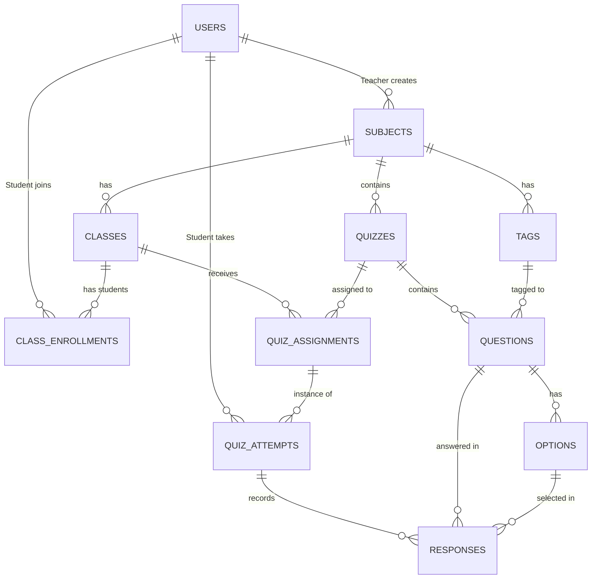

# InsightQuiz - Database Schema Design (PostgreSQL)

เอกสารนี้ใช้สำหรับอ้างอิงโครงสร้างฐานข้อมูล (Database Schema) ของโปรเจกต์ InsightQuiz โดยเน้นความสัมพันธ์ของระบบ Tagging และ Micro-Skill Analytics

## 📊 ER Diagram (Entity-Relationship)

*(หากดูใน VS Code สามารถติดตั้ง Extension: Markdown Preview Mermaid Support เพื่อแสดงเป็นภาพกราฟิกได้)*

---

## 🗄️ โครงสร้างตาราง (Table Definitions)

### 1. 👥 ระบบผู้ใช้งานและสิทธิ์ (Users & Roles)

**`users`** (เก็บข้อมูลทั้งครูและนักเรียน)
*   `id` (UUID, PK)
*   `role` (Enum: 'TEACHER', 'STUDENT')
*   `first_name` (Varchar)
*   `last_name` (Varchar)
*   `email` (Varchar, Unique)
*   `password_hash` (Varchar)
*   `created_at` (Timestamp)

### 2. 📚 ระบบโครงสร้างรายวิชา (Subjects, Tags, Classes)

**`subjects`** (รายวิชาหลัก)
*   `id` (UUID, PK)
*   `teacher_id` (UUID, FK -> users.id)
*   `name` (Varchar) - *เช่น Mathematics*
*   `created_at` (Timestamp)

**`tags`** (หัวข้อย่อยสำหรับทำ Analytics - **Core Engine**)
*   `id` (UUID, PK)
*   `subject_id` (UUID, FK -> subjects.id)
*   `name` (Varchar) - *เช่น เศษส่วน, สมการ*

**`classes`** (ห้องเรียน)
*   `id` (UUID, PK)
*   `subject_id` (UUID, FK -> subjects.id)
*   `name` (Varchar) - *เช่น M.4/1*
*   `class_code` (Varchar, Unique) - *รหัส 6 หลักให้นักเรียนกรอก*

**`class_enrollments`** (ตารางเชื่อม นักเรียน <-> ห้องเรียน)
*   `id` (UUID, PK)
*   `student_id` (UUID, FK -> users.id)
*   `class_id` (UUID, FK -> classes.id)
*   `joined_at` (Timestamp)

### 3. 📝 ระบบแบบทดสอบ (Quiz Builder)

**`quizzes`** (ชุดแบบทดสอบ)
*   `id` (UUID, PK)
*   `subject_id` (UUID, FK -> subjects.id)
*   `title` (Varchar)
*   `description` (Text)
*   `created_at` (Timestamp)

**`questions`** (คำถาม)
*   `id` (UUID, PK)
*   `quiz_id` (UUID, FK -> quizzes.id)
*   `tag_id` (UUID, FK -> tags.id) - *บังคับใส่เพื่อวิเคราะห์ผล*
*   `question_text` (Text)
*   `points` (Integer)
*   `question_type` (Enum: 'MULTIPLE_CHOICE', etc.)

**`options`** (ตัวเลือกคำตอบ)
*   `id` (UUID, PK)
*   `question_id` (UUID, FK -> questions.id)
*   `option_text` (Text)
*   `is_correct` (Boolean)

### 4. 🚀 ระบบสั่งงานและทำข้อสอบ (Assignment & Execution)

**`quiz_assignments`** (การสั่งข้อสอบให้แต่ละห้อง)
*   `id` (UUID, PK)
*   `quiz_id` (UUID, FK -> quizzes.id)
*   `class_id` (UUID, FK -> classes.id)
*   `time_limit_minutes` (Integer) - *เวลาในการทำข้อสอบ*
*   `deadline` (Timestamp) - *วันหมดเขต*
*   `status` (Enum: 'DRAFT', 'ACTIVE', 'CLOSED')

**`quiz_attempts`** (เซสชันการสอบของนักเรียน - ใช้คู่กับ Redis)
*   `id` (UUID, PK)
*   `assignment_id` (UUID, FK -> quiz_assignments.id)
*   `student_id` (UUID, FK -> users.id)
*   `start_time` (Timestamp)
*   `end_time` (Timestamp) - *เวลาที่เซิร์ฟเวอร์ตัดจบ*
*   `status` (Enum: 'IN_PROGRESS', 'SUBMITTED', 'FORCE_SUBMITTED')
*   `total_score` (Integer)

**`responses`** (คำตอบรายข้อ - ซิงค์มาจาก Redis ตอนจบการสอบ)
*   `id` (UUID, PK)
*   `attempt_id` (UUID, FK -> quiz_attempts.id)
*   `question_id` (UUID, FK -> questions.id)
*   `selected_option_id` (UUID, FK -> options.id)
*   `is_correct` (Boolean)
*   `score_earned` (Integer)

---

## 🧠 การทำงานของ Analytics (Data Flow)
เมื่อต้องการดูจุดอ่อนของนักเรียน (My Performance) ระบบจะคิวรี (Query) ข้อมูลโดย:
1. หา `responses` ทั้งหมดของนักเรียนคนนั้นในวิชานั้น
2. Join (เชื่อม) ตาราง `responses` เข้ากับ `questions` เพื่อดูว่าตอบคำถามข้อไหน
3. Join ไปที่ตาราง `tags` เพื่อดึงชื่อหัวข้อ (เช่น สมการ)
4. หาค่าเฉลี่ย `(คะแนนที่ได้ / คะแนนเต็ม) * 100` แยกตามกลุ่มของ `tag_id` เพื่อวาดกราฟ Radar Chart